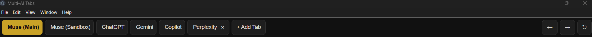
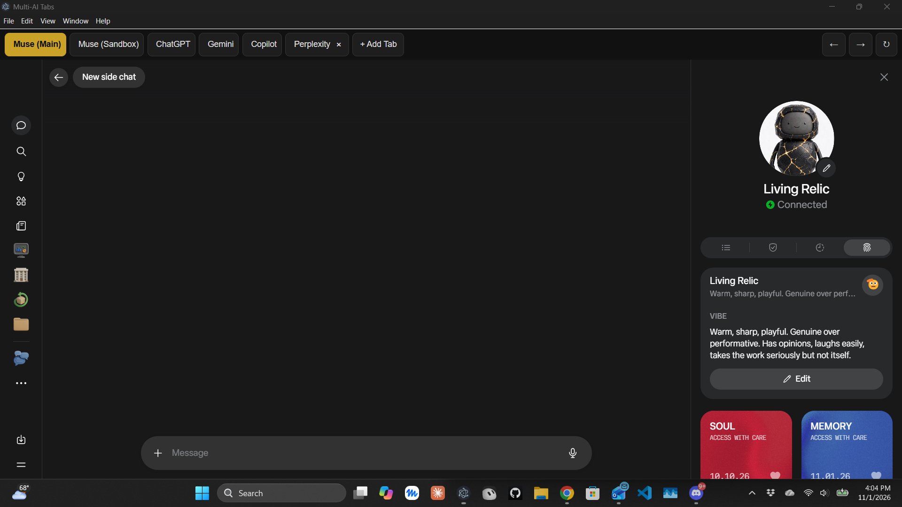
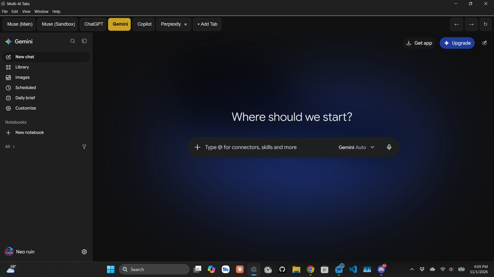
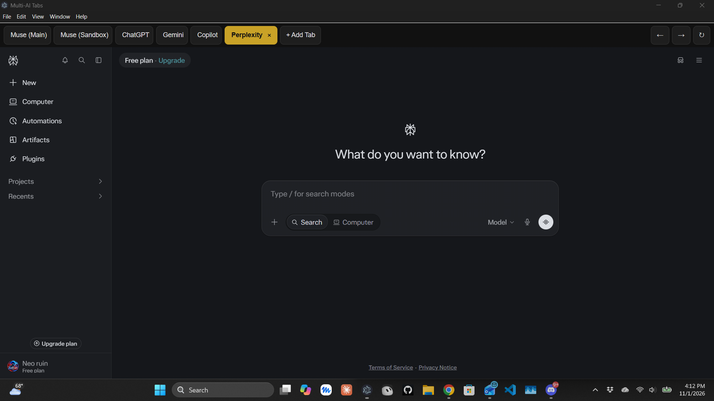

# Multi-AI Tabs

One window, one tab per AI account. Each tab keeps its **own separate login
session**, so your main Muse account and your sandbox Muse account can both
stay signed in at the same time — no incognito, no signing out and back in.
Switching accounts is just clicking a tab.

**This does NOT merge your accounts.** Each tab is that service's normal
website, with its own chats, artifacts, and login. Your main Muse chats stay
in your main account, your sandbox chats stay in your sandbox account.
The app only saves you the switching.

## Screenshots






## Tabs included

- Muse (Main) — muse.ai, main account
- Muse (Sandbox) — muse.ai, sandbox account (separate login)
- ChatGPT — chatgpt.com
- Gemini — gemini.google.com
- Copilot — copilot.microsoft.com

## Setup on your Windows PC (one step at a time)

1. Install **Node.js LTS** from https://nodejs.org/ if you don't have it
   (the big green "LTS" download button). Accept the defaults.
2. Copy this whole `multi-ai-wrapper` folder somewhere you'll keep it,
   for example `C:\Users\angelo\multi-ai-wrapper`.
3. Open that folder, click the address bar, type `powershell`, press Enter.
   (That opens PowerShell already pointed at the folder.)
4. Run: `npm install`
   First run only. It downloads Electron. It can take a few minutes.
5. Run: `npm start`
   The app opens with the Muse (Main) tab first.
6. Click the **Muse (Sandbox)** tab and sign into your sandbox account
   there. Click **Muse (Main)** and sign into your main account there.
   Do the same once for ChatGPT, Gemini, and Copilot if you use them.
7. From now on, just run `npm start` in that folder whenever you want it.
   Your logins stay saved on your PC — closing the app does NOT sign
   you out (that was the incognito problem).

## Everyday use

- Click a tab to switch accounts. The tab you left stays exactly where
  it was, still signed in.
- The ← → ↻ buttons at the top right are Back, Forward, and Reload for
  the tab you're on.
- If a site ever asks you to sign in again, check you're on the right
  tab first — Main and Sandbox are two different logins to the same site,
  so being in the wrong tab looks exactly like being signed out.

## Making a real exe (so you don't need PowerShell)

Version 1.2 adds packaging. Version 1.3 adds the app icon (a dark window
with gold, blue, and teal stacked tabs, in `build/icon.ico`) — the
installer and portable exe now show that icon instead of Electron's
default. Once, on your PC:

1. Close the app.
2. Unzip the new version over your existing folder, choose Replace.
3. In PowerShell in that folder, run: `npm.cmd install`
   (This time it also downloads the packaging tool. It takes longer
   than the first install — that is normal.)
4. Run: `npm.cmd run dist`
   This builds the exe files. It takes several minutes the first time.
5. When it finishes, look in the new `dist` folder inside the app folder.
   You will find two things:
   - **Multi-AI Tabs Setup.exe** — the installer. Run it once and it
     installs the app like any normal program, with a Start menu entry
     and (if you tick the box) a desktop shortcut. After that, just
     double-click the app like anything else — no PowerShell, ever.
   - **Multi-AI Tabs Portable.exe** — a single exe you can double-click
     without installing anything. Handy for a USB stick or a second PC.

One honest catch: the packaged app stores its data in its own folder,
separate from the version you run from PowerShell. So the first time
you open the installed (or portable) version, you will need to sign
into each tab once more, and re-add any custom tabs like Perplexity
once with + Add Tab. After that one-time setup, it sticks forever —
no PowerShell, no re-logins, and future updates built the same way
keep that same folder.

If the packaging step ever fails, the fallback is a desktop shortcut:
right-click `npm.cmd` is not the way — instead, make a shortcut to a
`.bat` file containing `npm.cmd start` in the app folder, and
double-click that. It opens the app without you typing anything, but
it is not a real exe, so the installer above is the better route.

## Adding a tab (no code needed)

Click **+ Add Tab** in the tab bar, type a name (for example
`Muse (Work)`) and the website address (for example `https://muse.ai/`),
and click **Add**. The new tab appears, you sign into it once, and it
stays signed in like the others. Added tabs are saved automatically,
so they are still there next time you open the app.

To remove a tab you added, click the **×** on its tab. Built-in tabs
(Muse Main, Muse Sandbox, ChatGPT, Gemini, Copilot) cannot be removed.
Removing a tab only hides it — its login stays saved, so adding a tab
with the same name again restores its login.

If you prefer editing code, you can still add a tab by adding a line to
the `DEFAULT_TABS` list in `main.js` — see "Adding another tab" below.
The + Add Tab button is just the easier way, and the one to tell other
people about.

## What's new in v2.0 — right-click menus, spellcheck, and the Watchtower

**Right-click now works everywhere.** v1 never built a right-click
menu, so right-clicking did nothing at all — no paste, no spellcheck.
v2 adds a full menu in every tab, in the tab bar, and in the sidebar:

- In a chat box: Cut, Copy, **Paste**, Paste as plain text, Select all.
  Paste handles text **and** pictures — copy an image, right-click the
  chat box, Paste, and it goes in.
- On a misspelled word (red underline): suggestions at the top, then
  **Add to dictionary**. Words you add stay learned across restarts.
  Spellcheck is US English, on in every tab.
- On a link: Open link in new tab, Copy link address.
- On an image: Copy image, Save image as…, Open image in new tab.
- Anywhere: Back, Forward, Reload, Inspect element.

One honest note: if a website has its own custom right-click menu,
that site's menu wins and ours doesn't appear. That's the browser's
own rule, not a bug.

**The Watchtower.** A collapsible sidebar on the left shows one row
per tab with a status light — Working (gold, pulsing), Done — check
it (green), Idle, No activity yet, or Needs attention (red, for a
failed load or a crash). Click any row to jump straight to that tab.
The **Watchtower** button in the top bar (or the ‹ button in the
sidebar) collapses it to a narrow strip of lights; it remembers
your choice.

How it knows, and what it doesn't: status is observed from outside
the tab only — page loads, title changes, and network activity on
that tab's session. **No code is injected into the AI tabs**, and
the Watchtower never sees message contents. A request has to run
for over ~1.5 seconds to count as "Working", so quick pings and
heartbeats don't set it off. "Done" means it was working, the
activity ended, and you haven't looked at the tab yet. Alerts are
**on by default**: a finished background tab highlights its row and
shows one Windows notification ("Muse (Main) finished — check it",
never any chat text). Click the notification to jump to the tab.
Turn alerts off with the checkbox at the bottom of the sidebar —
off stays off.

### v2.0.1 fix — tabs stuck on "Working"

Some tabs (Gemini, Perplexity) keep one background connection open
forever, and v2.0 counted that as "Working" forever. v2.0.1 drops a
tab back once it has shown Working for ~15 seconds with no new
activity. A real answer finishing still alerts normally.
If a tab flips while it is still answering, or sticks on Working
again, the 15-second limit is one number in main.js
(`WORKING_STALE_MS`) and can be tuned.

### v2.0.2 fix — sweeper wrongly said "Done"

v2.0.1's sweeper dropped a quiet tab to "Done — check it", which
reads as "your answer is ready" on a tab nobody used. v2.0.2
drops it to Idle instead: "Done" is now reserved for a real
finish (a request burst actually completing).

### v2.0.3 — "Needs attention" for approvals, and Alerts off means off

Two gaps found Nov 10: a tab waiting on an approval stayed Idle,
and a site's own notification popped up even with Alerts off.
v2.0.3 uses the notification permission ask as the signal — the
moment a site tries to notify you, its row goes red ("Needs
attention"). The Alerts switch now gates the popup itself too:
off means no notification from any tab, including the site's own.
Viewing the tab clears the red row. Caveat: a site that merely
checks notification permission can flash the row once — viewing
the tab clears it.

## Updating from v1.3 to v2.0

Close the app, unzip the new version over your existing folder, and
choose Replace when Windows asks about the files with the same names.
Your logins are safe: the built-in tabs kept their exact names and
login sessions, so they stay signed in. You do NOT need to run
`npm install` again (no new dependencies were added) — just run
`npm.cmd start` as usual. To rebuild the installer/portable exe,
run `npm.cmd run dist` again as in v1.2/v1.3.

## Updating from v1.0 to v1.1

Close the app, unzip the new version over your existing folder, and
choose Replace when Windows asks about the files with the same names.
Your logins are safe: the built-in tabs kept their exact names and
login sessions, so they stay signed in. You do NOT need to run
`npm install` again (no new dependencies were added) — just run
`npm.cmd start` as usual.

## Adding another tab

Open `main.js` in Notepad, find the `TABS` list near the top, and add one
line in the same format, for example:

```js
{ id: 'claude', label: 'Claude', url: 'https://claude.ai/', partition: 'persist:claude' },
```

Rules: every tab needs a unique `id` and a unique `partition`. Never
change a `partition` name for a tab you already signed into — that tab
will forget its login and you'll have to sign in again.

## Troubleshooting

- **"npm is not recognized"** — Node.js isn't installed, or PowerShell
  was opened before installing it. Close PowerShell, install Node.js,
  open a fresh PowerShell in the folder, try again.
- **Blank tab** — click ↻ Reload. If it persists, check your internet
  connection, then close and reopen the app.
- **Wrong account showing** — you're on the other Muse tab. Click the
  tab with the right label.
- **Want to sign out of one tab only** — sign out inside that service's
  website in that tab. The other tabs are untouched.

## Safety notes

- Your logins live only on your PC, in Electron's app data for this app.
  Nothing is sent to anyone else by this app.
- This app does not automate, scrape, or control the AI services. You
  use each service's website normally, by hand, inside its tab.
- Keep this folder private — anyone with access to your PC and this
  app's data could open your signed-in tabs.

